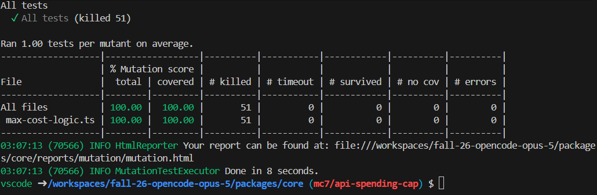

# Traceability: <Michael Chen> (mc7)

**Target feature:** API spending cap, found mainly in:
- packages/tui/src/component/dialog-session-max-cost.tsx
- packages/opencode/src/session/prompt.ts
- packages/core/src/session/runner/max-cost.ts
- packages/tui/src/app.tsx
- packages/core/src/session/max-cost-logic.ts

## Requirements

| ID | Interview evidence | Requirement | Acceptance Criteria | Changed in P4? | Property (kind) | Test | Mutants it Kills |
|---|---|---|---|---|---|---|---|
| R1 |C-1: It'd be nice to continuously see…when you're getting close to the limit.” |When the current session cost gets close to the session cost limit (for the first time), output a warning message. |After the current session cost crosses 90% of the session cost limit, output the following message: “WARNING: 90% of session cost has been used” |No |Invariant |packages/core/test/max-cost-logic.test.ts | H1 |
| R2 |C-1: “If the limit is set below the current cost, I would probably expect it to immediately output the stop message.” |If the session cost limit is set below the current session cost, immediately output a limit-reached warning message. |If the user inputs a session cost limit of $5 when the current session cost is $10, output the message: “session will halt before its next step” |No |Invariant |packages/core/test/max-cost-logic.test.ts | H2 |
| R3 |C-2, S-3, O-2: "The limit should go back to the previous $5 limit…It's more intuitive for there to be an undo button than needing to set the limit again." |There should be an prevMaxCost (undo) command for reverting the session cost limit after a change is made to it. |If the session cost limit is $5, then the user sets it to $10, the user should be able to enter the prevMaxCost command, which will revert the maxCost to $5 and output a “Spending limit reverted to $5” message. |Yes |Round-trip |packages/core/test/max-cost-logic.test.ts | H3 |
| R4 |C-3, O-3, S-4: “I would generally want it to round down, especially with how touchy money can be.” |If the user inputs a session cost limit with more than two decimal places, the input should be accepted, and the cost limit should always round down. |If the user inputs a session cost limit of $4.999, then the cost limit should be rounded down and set to $4.99. |No |Metamorphic |packages/core/test/max-cost-logic.test.ts | H4 |
| R5 |O-4: “...there shouldn't be any error. The displayed cost or limit should be to the nearest cent.” |The current session cost tracker should be accurate to the nearest cent. |If a user starts with a prompt that results in a $4.99 Claude charge, the current session cost should display exactly “$4.99 spent”. |No |Oracle |packages/core/test/max-cost-logic.test.ts | N/A |

Properties written or suggested by opencode or another AI tool: R1-R5 were all aided by Claude

## Requirement changes

| ID | Original requirement (P3) | Revised requirement | Why it changed |
|---|---|---|---|
|R3 |There should be an undo button for reverting the session cost limit after a change is made to it.|There should be an prevMaxCost (undo) command for reverting the session cost limit after a change is made to it.|The undo button would require a more work than it's worth, as adding a temporary additional button on the toast log is not very supported by the existing framework. The prevMaxCost command is a simple replacement for the undo button that fulfills the user need of undoing a change to the max cost.|

## Hand-written Mutants

| ID | Requirement Targeted | Change | Predicted Killer | Actual result |
|---|---|---|---|---|
| H1 | R1 | `max-cost-logic.ts`: shouldWarn's 90% limit check changed from >= to >, so no warning is sent if cost is at exactly 90% of the limit | 90%-cap warning fires once after 90% of limit is reached (R1) | Survived: the test checks that there's no more than one warning, but doesn't check for cases like no warnings should be sent. Steps skip from 80% to 100% of cap, but at 100%, shouldHalt is true and a 90% warning should not be sent, so the test doesn't work properly. |
| H2 | R2 | `max-cost-logic.ts`: shouldHalt's current cost vs new limit check is changed from >= to >, so no warning is sent even if the session cost limit is set to the current cost. | Session halts immediately when cost >= cap (R2) | Survived: the test passes in the generator twice and mistakenly treats it as the same value, but in reality two different values are being assigned to cost and maxCost, and as floats, they are almost never randomly assigned the exact same value. So the test passes anyway. |
| H3 | R3 | `max-cost-logic.ts`: revertMaxCost no longer checks if current.prevMaxCost is undefined, so the max cost might be reverted to an undefined value | \prevMaxCost reverts the session max cost (R3) | Survived: the test uses two values generated by money, which is a positive value, so undefined cases are never tested.|
| H4 | R4 | `max-cost-logic.ts`: remove the "+ 1e-9" from the rounding algorithm (Math.floor(n * 100 + 1e-9) / 100) in parseMaxCostInput, so tiny floating point inaccuracies can cause the maxCost to round incorrectly. | Any accepted input is truncated/rounded down to whole cents (R4) | Survived: the generator almost never randomly generates the exact decimal numbers that are slightly inaccurate from the underlying binary implementation of numbers. So, the test still passes in general. |

## Stryker Comparison

Stryker reported a mutation score of 43.14%. Stryker never generated H3, likely because H3 removed/changed more than a couple characters. It removed the undefined check, which was a whole line, so Stryker probably doesn't consider such large changes. I still thought it was a somewhat realistic mutant since the line is just to check the one undefined case. Stryker also never generated H4, likely also because the change of removing the +1e-9 is too large. I still thought this was a plausible mutant because it may not occur to everyone to include the inaccuracy safeguard or it may seem unnecessary and optional. The Stryker survivors generally demonstrate the weakness of the tests more than being plausible mutants, as a majority of them are doing things like replacing entire boolean expressions with just true/false, emptying string values, and replacing numbers with invalid values. I wouldn't think of these mutants because they don't seem plausible in the sense that the code itself would likely be caught if such hard coded values were used. Using hand-written mutants seems to help find more plausible mutants that expose more of the code's issues or lack of detail from code reviewers, whereas using Stryker finds many more mutants and thus does a much more exhaustive test of the properties themselves. 

After strengthening the properties, Stryker reports a final mutation score as 100%, as there are no equivalent mutants to be excluded.

## Agent Failure Case

Opencode Transcript:

Prompt (context was given earlier in the chat): "Write fast-check properties for at least 4 of the requirements in the table. Each property must:

Check the requirement's acceptance criteria for every generated input, not just the one example you wrote down in Project 3
Have a comment that names the requirement it checks, by ID and wording
Be listed in the Property and Test columns of your traceability table

Write the property for R1"

Response: " 
```// R1: After the current session cost crosses 90% of the limit for the
  // first time, output the warning exactly once; never again, and never
  // once the cap itself has been reached.
  // Kind: invariant
  test("R1: the 90%-of-cap warning fires at most once per session", () => {
    fc.assert(
      fc.property(
        fc.double({ min: 1, max: 100_000, noNaN: true }),
        fc.array(fc.double({ min: 0, max: 1, noNaN: true }), { minLength: 1, maxLength: 50 }),
        (maxCost, steps) => {
          let cost = 0
          let warned = false
          let warnCount = 0
          for (const step of steps) {
            cost += step * maxCost * 0.2
            if (shouldWarn(cost, maxCost, warned)) {
              warnCount++
              warned = true
            }
            if (shouldHalt(cost, maxCost)) expect(shouldWarn(cost, maxCost, false)).toBe(false)
          }
          expect(warnCount).toBeLessThanOrEqual(1)
        },
      ),
    )
  })
```

For your traceability table
ID	Property (kind)	Test
R1	invariant: warning fires at most once, never past the cap	R1: the 90%-of-cap warning fires at most once per session"

This generated property is an example where bugs are never reached. It fails mutant H1 (and several other mutants that Stryker found) because it misses many cases/boundaries. It doesn't test 90% cost threshold given the 20% increments, and it only provides an upper bound for number of warnings,using expect().toBeLessThanOrEqual, with no lower bound. 

New version (split):

```
 test("R1: 90%-cap warning fires at most once per session", () => {
    fc.assert(
      fc.property(
        fc.double({ min: 1, max: 100_000, noNaN: true }),
        fc.array(fc.double({ min: 0, max: 1, noNaN: true }), { minLength: 1, maxLength: 50 }),
        (maxCost, steps) => {
          let cost = 0
          let warned = false
          let warnCount = 0
          let shouldWarned = false;
          for (const step of steps) {
            cost += step * maxCost * 0.2
            if (cost >= maxCost * 0.9 && !shouldHalt(cost, maxCost)) {
              shouldWarned = true
            }
            if (shouldWarn(cost, maxCost, warned)) {
              warnCount++
              warned = true
            }
            if (shouldHalt(cost, maxCost)) expect(shouldWarn(cost, maxCost, false)).toBe(false)
          }
          if (!shouldWarned) {
            expect(warnCount).toEqual(0)
          } else {
            expect(warnCount).toEqual(1)
          }
        },
      ),
    )
  })

    // R1b: Warning never fires if it has already fired.
  test("R1: warning does not fire twice, but fires exactly at 90%", () => {
    fc.assert(
      fc.property(
        fc.double({ min: 1, max: 100_000, noNaN: true }),
        fc.double({ min: 0.9, max: 0.999, noNaN: true }),
        (maxCost, percentage) => {
          expect(shouldWarn(maxCost * percentage, maxCost, true)).toBe(false)
          expect(shouldWarn(0.9 * maxCost, maxCost, false)).toBe(true)
        },
      ),
    )
  })
```

Now, H1 and the Stryker mutants pass, as there's a score of 100%:
